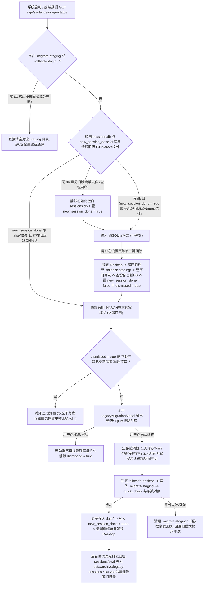

# JeikCode 存储架构收敛、高并发改造与 SQLite 平滑迁移实施文档

- **日期**：2026-11-20
- **分支 / 基线**：`beta`（`dba349644`）
- **状态**：架构设计与实施规划（待分波落地）
- **文档定位**：JeikCode 底层存储向 SQLite 收敛、HTTP 异步 I/O 零阻塞改造、Agent 全链路观测时间线建设以及旧版文件平滑迁移的完整工程实施蓝图。

---

## 一、背景与现状问题

### 1.1 磁盘实测现状（2026-11-20 本地 `~/.jeikcode/` 真实诊断样本）
当前全局目录 `~/.jeikcode/` 总占用已超 **2.48 GB**，存在严重的目录杂乱与文件碎片爆炸，仅 `sessions/` 就包含 **41,044 个文件（2,312.55 MB）**：

| 目录 / 文件类别 | 现存体量 / 数量 | 核心问题 |
| :--- | :--- | :--- |
| **`sessions/`（`.artifacts/` 除外）** | 持续膨胀至万级文件 / 近 2 GB | 单会话分裂为十余种旁路文件（`.meta`、`.snapshot(.inflight)`、`.jsonl`、`.display.jsonl`、`.display.idx.jsonl`、`.display.meta.json`、`.ui.json`、`.rewind.json`、`.toolmetrics.jsonl`、`.model-switches.jsonl`、**`.trace.jsonl(.old)`**、`.bashkw.json`、`.todo`、`.pending_permission.json`、`.images.json`）。除对话原文与 Base64 重复存 3~4 遍（`.snapshot` 达 `19.12 MB`、`.display.jsonl` 达 `15.45 MB`）外，新增无损请求账本 **`.trace.jsonl` 单会话已达 `21.74 MB`**，成为新的文本膨胀源。 |
| **`sessions/*/*.artifacts/`** | `33,262+` 个文件（`575+` 个目录）/ `326.48+ MB` | 海量无后缀小文件，被迫维护 [artifact_watchdog.rs](../crates/jeikcode-capabilities/src/tools/artifact_watchdog.rs)（`ArtifactWatchdog`）后台 3ms 限速扫盘淘汰协程。 |
| **孤儿残留与零字节锁** | **`2,270` 个 0 字节锁/租约文件**；`987` 个 UUID 中 **`160` 个为无主孤儿** | `SessionManager::delete` 刻意保留 `.lease`/`.lock` 且漏删 `.display.idx.jsonl`，无跨文件事务导致半残孤儿不断堆积；`task` 子代理会话按独立 UUID 落盘进一步放大文件数。 |
| **外围散落目录与运行态** | `session-inputs/`、`session-partials/`、`state/queues/`、`backups/`、`datalog/`、**`eval/bundles/`**、**`logs/`（`11.77 MB`，含 `jeikcode.log(.old)` / `jeikcode-daemon.log` / `panic.log`）**、`schedules/` | 运行态与日志横跨多个顶层目录（`.runtime_state`、`sidebar-projects.json`、`git-bindings.json`、`git-poll-state.json`、`recent_dirs.txt`、`history`、`mcp_trust.json`、`skills.json`、`webui-listen.json` 等与用户可编辑配置 `config.toml`/`desktop-settings.json` 混杂）；`eval/bundles/` 另起独立配额裁剪线程扫盘。 |

### 1.2 代码架构与高并发痛点（“4~5 个长任务 HTTP 即卡死”的根因）
`GET /stream/ws`（[streamMux.ts](../webui/src/lib/streamMux.ts)）多路复用、`GET /api/bootstrap`、尾窗 `?tail=` ETag 304、`scan_session_in_bucket` O(1) 定位及 `api_git`/`resolve_session`/`get_session_detail` 的 `spawn_blocking` 虽已治理首屏与 Git 阻塞，但高并发下仍存在以下核心阻塞源：

1. **Tokio 异步工作线程被同步阻塞 I/O 与全局写日志占满（Head-of-Line Blocking）**：
   * **全链路 Trace / Metric 同步锁写盘**：[eval_trace.rs](../crates/jeikcode-capabilities/src/session/eval_trace.rs) 的 `SessionTraceHook` 与 `SessionTraceStart/EndMiddleware` 在 `#[async_trait]` 钩子内持 `std::sync::Mutex`（`io_lock`）同步序列化并 `OpenOptions::write_all` 写入 `.trace.jsonl(.old)`、`eval/bundles/<sha256_16>.json` 与 `.toolmetrics.jsonl`，并在达阈值时直接 `std::thread::spawn` 扫目录裁剪；
   * **全局同步文件日志锁**：[logging.rs](../crates/jeikcode-daemon/src/logging.rs) 使用 `tracing_subscriber::fmt().with_writer(Mutex::new(file))` 向 `logs/jeikcode.log(.old)` 与 `logs/jeikcode-daemon.log` 同步落盘，并发写 `tracing::info!/warn!` 时多线程在 Tokio Worker 上竞争同一把文件锁；
   * **会话与调度同步读写**：[codeintel/explore.rs](../crates/jeikcode-capabilities/src/codeintel/explore.rs)（`code_explore`）、[session/recall.rs](../crates/jeikcode-capabilities/src/session/recall.rs)（`RecallTool`）、[display.rs](../crates/jeikcode-capabilities/src/session/display.rs)、[snapshot.rs](../crates/jeikcode-capabilities/src/session/snapshot.rs)、[transcript.rs](../crates/jeikcode-capabilities/src/session/transcript.rs)、[inputs.rs](../crates/jeikcode-capabilities/src/session/inputs.rs)、[api_schedule.rs](../crates/jeikcode-daemon/src/api_schedule.rs)（`schedule_store_lock()` 读写 `schedules/*.json`）以及 [jeikcode-daemon/src/lib.rs](../crates/jeikcode-daemon/src/lib.rs)（`admit_chat_turn` / `persist_admitted_user` / `chat_steer`）、[live_api.rs](../crates/jeikcode-daemon/src/live_api.rs)、[compat_api.rs](../crates/jeikcode-daemon/src/compat_api.rs) 仍在异步路径直接运行同步 `std::fs` 与全盘扫描。
2. **全局大锁与硬并发天花板**：
   * [session_runtime_registry.rs](../crates/jeikcode-coding/src/session_runtime_registry.rs) 硬编码 `MAX_LIVE_SESSIONS = 32`；
   * `ActiveChatRegistry`（单把 `RwLock`，同时承担运行期模型热切换句柄登记）、`QUEUE_CLAIM_LOCK`（跨多个 `.await` 持锁读写队列文件）、`SessionRuntimeRegistry::entries`、`display_log_cache()` 均为进程级全局单锁。
3. **执行链路可观测性多套割裂**：
   * 当前存在 [eval_trace.rs](../crates/jeikcode-capabilities/src/session/eval_trace.rs)（`<id>.trace.jsonl` + `eval/bundles/`）、[tool_metrics.rs](../crates/jeikcode-capabilities/src/session/tool_metrics.rs)（`.toolmetrics.jsonl`）、[model_switch_log.rs](../crates/jeikcode-capabilities/src/session/model_switch_log.rs)（`.model-switches.jsonl`）、`SystemNotice` 结构化事件及 `datalog/` 五套并行持久化体系，缺乏统一索引与父子 Span 级联视图，运维与 Agent 无法通过单次索引查询定位耗时、429 重试与“兜圈”特征。

---

## 二、建设目标

1. **目录与存储极致收敛**：目录从 40,000+ 碎片收敛为 **`data/sessions.db` + `data/telemetry.db` + `data/blobs/`**；彻底消除孤儿锁、重复内联 Base64 与手写索引补丁。
2. **DataInfra 平滑替换**：保持上层业务字段契约（`SessionDetail`、`MessageInfo`、`SessionSnapshot`、`CatalogSessionView`）稳定不变，`webui/` 与 `desktop/` 主逻辑无需推翻重写。
3. **全场景高速检索与链路自诊断**：支持按标题、工作区、时间范围、消息全文（FTS5）、`part_id`/`call_id`/`event_id` 毫秒级反查会话；建立统一树形执行时间线，支持耗时归因、异常重试追溯与同文件/同错误“兜圈”检测。
4. **极限负载下 HTTP 绝对零阻塞**：支持 **40+ 活跃会话 × 2~3 个并发子代理（120~160+ 并发流）+ 多端长连接高频读写**，保证本地任何磁盘或计算负载不阻塞异步 HTTP 收发。
5. **零损坏、有温度的迁移体验**：未迁移时静默降级读 JSON；复用现有启动高级弹窗引导，提供预计耗时、“不再提醒”与齿轮设置重开入口；后台安全建库、校验对账、完成后打标 `new_session_done` 并压缩归档老文件。

---

## 三、参考借鉴与设计原则

### 3.1 借鉴兄弟项目 `Antigravity-Manager` 的实战经验
经过源码级审计（`Antigravity-Manager` 仓库的 `src-tauri/src/modules/proxy_db.rs`、`src-tauri/src/proxy/signature_cache.rs`、`src-tauri/src/proxy/adapters/artifact_store.rs`），直接吸收以下 6 项经过验证的工程模式：
1. **读写连接池严格隔离**：借鉴 `ToolSignatureWriteDb`（单写连接）+ `ToolSigReadPool`（`SQLITE_OPEN_READ_ONLY` 多连接轮询池），实现多读并行与读不阻塞写。
2. **专用写线程 Actor + 5ms 微批聚合 + 删除优先守卫**：借鉴 `ag-tool-sig-writer` 双通道设计（高优先级 `delete_rx` + 普通 `save_rx`）与 `PENDING_SESSION_DELETES` 机制，先排空删除队列并拦截旧写入，防止“删后幽灵复活”。
3. **跨进程并发显式设置 `busy_timeout = 5000` + `spawn_blocking` 隔离**：避免 `rusqlite` 默认 `0ms` 超时导致的瞬时 `SQLITE_BUSY`，且绝不在 Tokio async 线程持有同步锁。
4. **温和增量空间回收（不锁表 `VACUUM`）**：开启 WAL **前**设置 `PRAGMA auto_vacuum = INCREMENTAL`，清理后先 `wal_checkpoint(TRUNCATE)` 再分步执行 `PRAGMA incremental_vacuum(1000)`。
5. **阈值透明压缩与物理分库**：大体积长日志库与低延迟核心状态库物理拆开；超阈值长文本用魔数前缀按需 zstd/gzip 压缩，短文本零压缩开销。
6. **Partial Index 与 `chunks(500)` 批量 `IN`**：用 `WHERE col IS NOT NULL` 瘦身索引，用分片 `IN` 替代循环 N+1 点查。

### 3.2 结合互联网 SQLite 高并发权威原则与本仓踩坑修正
| 原则 / 隐患 | 行业权威规范与本仓现有对照 | JeikCode 新架构强制规范 |
| :--- | :--- | :--- |
| **写锁升级死锁防护** | `Antigravity-Manager` (`unchecked_transaction()`) 与本仓 [index_db.rs](../crates/jeikcode-capabilities/src/codeintel/index_db.rs) (`conn.transaction()`) 均用默认 `DEFERRED`。并发连接同时升级写锁会无视 `busy_timeout` 立即报错。 | **全部写事务强制 `TransactionBehavior::Immediate` (`BEGIN IMMEDIATE`)**，入口即抢占预留写锁。 |
| **数据精准性与防坏库** | 本仓 [index_db.rs](../crates/jeikcode-capabilities/src/codeintel/index_db.rs) 为图快设了 `synchronous = OFF`（掉电即毁库）。 | **会话与观测库严格使用 `PRAGMA synchronous = NORMAL`**（WAL 下既省掉每笔 `fsync`，又保证掉电绝不损坏库结构）。 |
| **防 WAL Checkpoint 饥饿** | 读连接若长持未关闭的游标/读事务，会导致 `-wal` 无限膨胀拖垮全库读取。 | 只读池严格在 `spawn_blocking` 内短查询并立即 `drop(rows)`；写连接配置 **`journal_size_limit = 67108864` (64MB)** 与 **`wal_autocheckpoint = 1000`**。 |
| **强一致 vs 异步缓冲分级** | 会话消息/Turn 提交不可“假成功”丢在后台队列。 | **主数据写（`sessions.db`）采用 Actor + `oneshot` 等待提交回执**（微秒级短事务，强一致）；**埋点写（`telemetry.db`）采用 10ms 微批聚合成批**（零阻塞）。 |
| **Schema 演进安全** | 避免吞错式 `let _ = conn.execute("ALTER TABLE ...")`。 | 统一采用 **`PRAGMA user_version`** + 事务化顺序迁移脚本，启动执行 `PRAGMA quick_check`。 |

---

## 四、数据迁移总策略（只换 DataInfra 来源层）、分类归宿与索引架构

### 4.0 代码层迁移总策略：只换 `DataInfra` 数据来源层，上层业务零破坏
* **核心原则**：上层服务（`jeikcode-daemon` HTTP/SSE 接口、`jeikcode-tuix` 终端视图、`jeikcode-coding` 上下文加载）所需的字段结构（`SessionDetail`、`MessageInfo`、`SessionSnapshot`、`CatalogSessionView`）保持完全稳定不变，**仅将底层数据源从“多目录 JSON/JSONL 拼装”替换为统一的数据访问接口 `DataInfra`（`SessionRepo` + `TelemetryRepo`）**。
* **双引擎路由切换**：在启动期根据 `new_session_done` 状态选择实现后端——未迁移前挂 `LegacyFsInfra`（静默读写旧 JSON），迁移完成后切至 `SqliteDataInfra`（读走只读连接池 + 索引，写走单写 Actor），对外输出由统一 `ProjectionMapper` 组装，实现前端 `webui/` 与桌面壳核心零改造成本。

#### 全量数据来源 6 大类归类与目标库文件映射

| 数据分类 | 原分散文件 / 路径来源 | 归入新架构目标位置 | 归类与隔离理由 |
| :--- | :--- | :--- | :--- |
| **1. 会话主状态与模型上下文** | `sessions/<hash>/*.meta`（含 `origin` / `parent_session_id` / `parent_call_id` / `approval_mode` / `TurnStat.stop_reason`）、`*.snapshot(.inflight)`、`*.jsonl`、`*.rewind(.txn).json`、`*.json`（旧 core 格式）、`.catalog-index.json`、`backups/` | **`data/sessions.db`**<br>(`sessions` / `context_snapshots` / `rewind_points` / `timeline_items` / `timeline_fts`) | 核心资产强一致，需 ACID 事务删除/回滚及标题、时间、全文高频检索；图片改存 `sha256` 引用后单行缩小 5~10 倍；原生区分 `manual`/`scheduled`/`protocol`/`subagent` 四态与父子谱系。 |
| **2. 人类前端展示与增强预览** | `sessions/<hash>/*.display.jsonl`（含流式检查点）、`*.display.meta.json`、`*.display.idx.jsonl`、`*.ui.json`、`*.images.json`、`*.model-switches.jsonl`（运行期切换卡片）、前端现算 `edit` diff | **`data/sessions.db`** (`timeline_items` + `timeline_parts` 标记 `audience='ui_only'`/`'both'` + `model_switch` 锚点 + 预渲染 Diff) + **`data/blobs/`** (原图实体；项目内 `{cwd}/.jeikcode_store/` 附件维持原路径引用) | 与上下文合并进统一时间线并靠 `audience` 与 `turn_id` 严格隔离，原生支持跳过中途 `steer` 贴齐回合根分页（`ElapsedBadge` / `turnTimer` 耗时稳定），直接消灭三份文本冗余和运行时多文件拼装。 |
| **3. 交互瞬态、输入排队与锁** | `session-inputs/`（含 `operation_id` / `anchor_message_id` / `turn_id`）、`session-partials/`、`state/queues/`、`sessions/<hash>/*.lease` / `*.lock` / `*.pending_permission.json` / `*.todo` / `*.bashkw.json` | **`data/sessions.db`**<br>(`session_inputs` / `session_leases` / `kv_state`) | 全部收敛进事务型小表与 DB 租约表，彻底消灭 2,270 个 0 字节锁文件与 160 个孤儿残留，并持久保留 Steer 折叠因果锚点。 |
| **4. 执行链路指标、无损评测账本与审计** | `sessions/<hash>/*.trace.jsonl(.old)`、`eval/bundles/<sha256_16>.json`、`sessions/<hash>/*.toolmetrics.jsonl`（含 `switch_ms` / `approval_wait_ms` / `repaired_args` / `target_hint` / `truncated`）、`SystemNotice` 重试/限流/软着陆通知、`datalog/`、`codegraph/logs/` | **`data/telemetry.db`**<br>(`trace_spans` + `eval_round_deltas` + `trace_errors_fts`) + **`data/blobs/`**（`kind='eval_bundle'` 去重压缩包）；气泡通知同步锚定 `sessions.db.timeline_parts` | 与会话主库物理拆库，替代 21MB+ `.trace.jsonl` 与独立后台裁剪线程；通过 `prefix_keep + messages_delta`（zstd）与 `eval_bundle` 保留 100% `reconstruct_upstream_request` 无损重放及父子 `SessionEvalReport` 汇总能力。 |
| **5. 大体积工具产物、请求包与二进制池** | `sessions/<hash>/*.artifacts/*`（33,262+ 个产物）、`eval/bundles/*`、重复内联 Base64 图片、`image-cache/` | **实体进 `data/blobs/`** (按 `sha256` 去重 + zstd 压缩)；**索引进 `data/sessions.db` (`blobs_meta`)**；缩略图/模型缓存进 **`cache/`** | 避免数十 MB 二进制与静态请求包拖垮 SQLite 页缓存与 WAL checkpoint；淘汰 `ArtifactWatchdog` 与 `prune_eval_storage` 两套后台扫盘，改为一条 SQL LRU 清理。 |
| **6. 人类配置、跨进程共享配置与兜底运行态** | ① 人类与多端共享配置：`config.toml`、`auth.toml`、`mcp.json`、`hooks.json`、`desktop-settings.json`（Tauri 壳监听）、`schedules/`（CLI/TUI/Daemon/OS 调度共用）、`AGENTS.md`、`memory.md`、`user-wrap.md`、`prompts/`、`skills/`、`commands/`、`plugins/`、`thesaurus/`、`teaches/`、`.codegraphignore*`<br>② 根目录机器状态：`sidebar-projects.json`、`git-bindings.json`、`git-poll-state.json`、`recent_dirs.txt`、`history`、`mcp_trust.json`、`skills.json`、`.last_seen_version`、`.plugin_bootstrap_v2`<br>③ 文本日志与运行态：`logs/jeikcode.log(.old)`、`logs/jeikcode-daemon.log(.old)`、`panic.log`、`wire-dump/`、`.runtime_state`、`webui-listen.json`、`notify-focus.*`、`telemetry/` 队列、`cache/staged/` | ① **保留根目录与配置子目录**（不入库，`api_schedule.rs` 读写进 `spawn_blocking`）<br>② 根目录机器状态 $\rightarrow$ **`data/sessions.db` (`kv_state`)**<br>③ 文本日志（改无锁非阻塞写）$\rightarrow$ **`logs/`**；进程哨兵/端口/队列 $\rightarrow$ **`runtime/`**；双轨更新安装包暂存 $\rightarrow$ **`cache/staged/`** | `desktop-settings.json` 与 `schedules/` 需由无 SQLite 依赖的 Tauri 外壳及 CLI 共享访问；人类配置保留 mtime 热重载；崩溃日志纯文本兜底；其余状态收敛进 `kv_state` 与 `runtime/`。 |

### 4.1 迁移后 `~/.jeikcode/` 目标目录结构
贯彻 **“人类与多端配置在根目录/配置目录、机器持久化进 `data/`、兜底日志进 `logs/`、易失态进 `cache/` 与 `runtime/`”**：

```text
~/.jeikcode/
├── config.toml / auth.toml / mcp.json / hooks.json / desktop-settings.json
├── AGENTS.md / memory.md / user-wrap.md / .codegraphignore / .codegraphignore.graph
├── schedules/ | prompts/ | skills/ | commands/ | plugins/ | thesaurus/ | teaches/
│
├── data/                            # 核心持久化区（迁移/备份仅需关注此目录+配置）
│   ├── sessions.db                  # 会话主库（+ -wal / -shm）
│   ├── telemetry.db                 # 全链路耗时/重试/兜圈与无损请求重放库（+ -wal / -shm）
│   ├── new_session_done             # 迁移完成权威标记文件（JSON 元数据）
│   ├── blobs/                       # 内容寻址去重池（ab/cd... 存图片、大产物与 eval_bundle）
│   └── archive/                     # 迁移完成后旧数据单包归档 (legacy-sessions-YYYYMMDD.tar.zst)
│
├── logs/                            # 文本兜底日志区（logging.rs 非阻塞异步 5MB 滚动写）
│   ├── jeikcode.log(.old)
│   ├── jeikcode-daemon.log(.old)
│   ├── panic.log
│   ├── bash-bg/                     # 后台 bash 子进程临时流日志
│   └── wire-dump/                   # 仅 JEIKCODE_WIRE_DUMP=1 开启
│
├── cache/                           # 可随时清空的易失缓存
│   ├── models-dev.json
│   ├── thumbnails/                  # 原 image-cache/
│   └── staged/                      # Path A 热更包 + Path B 双轨桌面安装包与校验缓存
│
└── runtime/                         # 进程运行态（不再污染根目录）
    ├── .runtime_state               # 进程生命周期状态哨兵
    ├── webui-listen.json
    ├── notify-focus.ps1 / .vbs
    └── telemetry-queue/             # 产品遥测待上传队列
```

### 4.2 统一时间线与双库 Schema + 常用索引设计

#### A. 主会话库 `data/sessions.db`
核心思想：**用“统一时间线表 + 部件表 + 观众可见性标记”替代原来的 15+ 种碎片文件**，并建立覆盖“会话 ID / 标题 / 部件 ID / 部件分列全文关键词 / 报错日志 / 跳过中途 steer 贴齐回合根分页 / 子代理级联”的完备索引体系。

```sql
-- 1. 会话主表（替代 .meta + .catalog-index.json + 会话级 .ui.json）
CREATE TABLE sessions (
    id                  TEXT PRIMARY KEY,
    project_bucket      TEXT NOT NULL,
    working_dir         TEXT NOT NULL,
    name                TEXT NOT NULL,
    user_renamed        INTEGER NOT NULL DEFAULT 0,
    ai_named            INTEGER NOT NULL DEFAULT 0,
    origin              TEXT NOT NULL DEFAULT 'manual', -- manual | scheduled | protocol | subagent
    protocol_key        TEXT,
    parent_id           TEXT,                            -- Fork 父会话 或 task 子代理父会话 ID
    parent_call_id      TEXT,                            -- task 子代理关联的父工具调用 call_id
    fork_info_json      TEXT,
    import_info_json    TEXT,
    preferred_model     TEXT,
    approval_mode       TEXT,                            -- build | accept_edits | bypass | plan
    reasoning_effort    TEXT,
    thinking_budget     INTEGER,
    turn_count          INTEGER NOT NULL DEFAULT 0,
    message_count       INTEGER NOT NULL DEFAULT 0,
    turn_stats_json     TEXT NOT NULL DEFAULT '[]',
    detached_usage_json TEXT NOT NULL DEFAULT '[]',
    compacted_tokens    INTEGER,
    generation          INTEGER NOT NULL DEFAULT 1,      -- Fencing Epoch：防删后僵尸写入复活
    created_at_ms       INTEGER NOT NULL,
    updated_at_ms       INTEGER NOT NULL,
    deleted_at_ms       INTEGER
);
CREATE INDEX idx_sessions_visible ON sessions(project_bucket, updated_at_ms DESC) WHERE deleted_at_ms IS NULL AND origin NOT IN ('scheduled', 'subagent') AND parent_id IS NULL;
CREATE INDEX idx_sessions_bucket_time ON sessions(project_bucket, origin, updated_at_ms DESC) WHERE deleted_at_ms IS NULL;
CREATE INDEX idx_sessions_updated ON sessions(updated_at_ms DESC) WHERE deleted_at_ms IS NULL;
CREATE INDEX idx_sessions_created ON sessions(created_at_ms DESC) WHERE deleted_at_ms IS NULL;
CREATE INDEX idx_sessions_name ON sessions(name COLLATE NOCASE) WHERE deleted_at_ms IS NULL;
CREATE INDEX idx_sessions_workdir ON sessions(working_dir) WHERE deleted_at_ms IS NULL;
CREATE INDEX idx_sessions_proto ON sessions(protocol_key) WHERE protocol_key IS NOT NULL AND deleted_at_ms IS NULL;
CREATE INDEX idx_sessions_parent ON sessions(parent_id, origin) WHERE parent_id IS NOT NULL;

-- 会话标题与路径全文模糊索引（支持标题/目录任意子串关键词快速搜会话）
CREATE VIRTUAL TABLE sessions_fts USING fts5(
    session_id UNINDEXED,
    project_bucket UNINDEXED,
    name,
    working_dir,
    tokenize = 'unicode61'
);

-- 2. 统一时间线节点表（替代 .display.jsonl + .jsonl + .ui.json + .display.idx.jsonl）
CREATE TABLE timeline_items (
    id                  TEXT PRIMARY KEY,                -- message_id 或 event_id
    session_id          TEXT NOT NULL REFERENCES sessions(id) ON DELETE CASCADE,
    turn_id             INTEGER NOT NULL DEFAULT 0,
    seq                 INTEGER NOT NULL,                -- 会话内严格单调递增，游标分页唯一依据
    item_kind           TEXT NOT NULL,                   -- message | system_event | model_switch | checkpoint
    role                TEXT NOT NULL,                   -- user | assistant | tool | system
    audience            TEXT NOT NULL DEFAULT 'both',    -- both | ui_only | context_only
    synthetic           INTEGER NOT NULL DEFAULT 0,
    is_root_turn        INTEGER NOT NULL DEFAULT 0,      -- 1 表示回合根用户提问（非中途 [jeikcode-steer]）
    internal_origin     TEXT,
    content_text        TEXT NOT NULL DEFAULT '',        -- 正文明文或 zstd 阈值压缩句柄
    reasoning_text      TEXT,                            -- 思考链原文（与正文分离存储与检索）
    client_input_id     TEXT,
    stop_reason         TEXT,                            -- 对齐 TurnStat.stop_reason（含 max_rounds 软着陆）
    is_error            INTEGER NOT NULL DEFAULT 0,
    editable            INTEGER NOT NULL DEFAULT 1,
    elapsed_ms          INTEGER,
    created_at_ms       INTEGER NOT NULL
);
CREATE UNIQUE INDEX idx_timeline_session_seq ON timeline_items(session_id, seq);
CREATE INDEX idx_timeline_turn ON timeline_items(session_id, turn_id, seq);
CREATE INDEX idx_timeline_turn_root ON timeline_items(session_id, is_root_turn, seq) WHERE audience != 'context_only';
CREATE INDEX idx_timeline_outline ON timeline_items(session_id, role, synthetic, seq) WHERE audience != 'context_only';
CREATE INDEX idx_timeline_client_input ON timeline_items(session_id, client_input_id) WHERE client_input_id IS NOT NULL;
CREATE INDEX idx_timeline_created ON timeline_items(created_at_ms DESC);
CREATE INDEX idx_timeline_errors ON timeline_items(session_id, created_at_ms DESC) WHERE is_error = 1;

-- 3. 时间线部件表（绑定工具调用/入参/返回输出、系统事件卡、模型切换胶囊、Edit Diff 增强、图片 Blob 引用）
CREATE TABLE timeline_parts (
    part_id             TEXT PRIMARY KEY,
    session_id          TEXT NOT NULL REFERENCES sessions(id) ON DELETE CASCADE,
    item_id             TEXT NOT NULL REFERENCES timeline_items(id) ON DELETE CASCADE,
    turn_id             INTEGER NOT NULL DEFAULT 0,
    part_order          INTEGER NOT NULL DEFAULT 0,
    part_kind           TEXT NOT NULL,                   -- text | reasoning | tool_call | tool_result | system_event | model_switch | diff_preview | image
    audience            TEXT NOT NULL DEFAULT 'both',    -- both | ui_only (如 edit diff / system_event / model_switch)
    call_id             TEXT,
    event_id            TEXT,
    anchor_item_id      TEXT,
    anchor_part_id      TEXT,
    notice_kind         TEXT,                            -- retry | stream_resume | rate_limit | timeout | compaction | truncation | warning | error
    severity            TEXT,                            -- info | warning | error
    status              TEXT,                            -- active | settled | running | done | error
    revision            INTEGER NOT NULL DEFAULT 1,
    tool_name           TEXT,
    is_error            INTEGER NOT NULL DEFAULT 0,
    payload_json        TEXT,                            -- 工具入参/输出摘要/报错栈/模型切换/预计算 Edit Diff（.jeikcode_store/ 路径保留）
    blob_sha256         TEXT,                            -- 关联 data/blobs/（图片与超长输出完全去重）
    created_at_ms       INTEGER NOT NULL,
    updated_at_ms       INTEGER NOT NULL
);
CREATE INDEX idx_parts_item ON timeline_parts(item_id, part_order);
CREATE INDEX idx_parts_session_kind ON timeline_parts(session_id, part_kind, created_at_ms DESC);
CREATE INDEX idx_parts_session_event ON timeline_parts(session_id, event_id) WHERE event_id IS NOT NULL;
CREATE INDEX idx_parts_call_id ON timeline_parts(call_id) WHERE call_id IS NOT NULL;
CREATE INDEX idx_parts_tool_name ON timeline_parts(session_id, tool_name, is_error) WHERE tool_name IS NOT NULL;
CREATE INDEX idx_parts_errors ON timeline_parts(is_error, severity, created_at_ms DESC) WHERE is_error = 1 OR severity = 'error';
CREATE INDEX idx_parts_notice ON timeline_parts(notice_kind, status, updated_at_ms DESC) WHERE notice_kind IS NOT NULL;
CREATE INDEX idx_parts_blob ON timeline_parts(blob_sha256) WHERE blob_sha256 IS NOT NULL;

-- 4. 多部件独立分列 FTS5 全文检索虚拟表（支持跨会话 & 会话内按部件精确检索，直达 item_id + part_id）
CREATE VIRTUAL TABLE timeline_fts USING fts5(
    session_id UNINDEXED,
    item_id UNINDEXED,
    part_id UNINDEXED,
    project_bucket UNINDEXED,
    turn_id UNINDEXED,
    created_at_ms UNINDEXED,
    content_text,       -- 助手/用户正文
    reasoning_text,     -- 模型思考 <think> 内容
    tool_name,          -- 工具名 (read_file / edit / bash / code_explore...)
    tool_args,          -- 工具调用参数（文件路径、命令、正则表达式等）
    tool_output,        -- 工具返回/标准输出/报错正文
    notice_text,        -- 系统事件/报错/重试通知文本
    tokenize = 'unicode61'
);

-- 5. 上下文快照表（替代每次 Turn 全量重写 19MB .snapshot，图片只存 sha256 引用）
CREATE TABLE context_snapshots (
    session_id          TEXT PRIMARY KEY REFERENCES sessions(id) ON DELETE CASCADE,
    turn_counter        INTEGER NOT NULL DEFAULT 0,
    request_counter     INTEGER NOT NULL DEFAULT 0,
    cache_epoch         INTEGER NOT NULL DEFAULT 0,
    model               TEXT,
    payload_blob        BLOB NOT NULL,                   -- zstd 压缩后的紧凑 SessionSnapshot JSON/bincode
    inflight_blob       BLOB,                            -- 运行中临时恢复点
    inflight_replayable INTEGER NOT NULL DEFAULT 0,
    updated_at_ms       INTEGER NOT NULL
);

-- 6. 附属状态收口表（替代 .rewind.json / session-inputs / session-partials / state/queues / .lease / 根目录机器状态）
CREATE TABLE rewind_points (
    id                  INTEGER PRIMARY KEY AUTOINCREMENT,
    session_id          TEXT NOT NULL REFERENCES sessions(id) ON DELETE CASCADE,
    turn_id             INTEGER NOT NULL,
    prompt_number       INTEGER NOT NULL,
    prompt_preview      TEXT NOT NULL,
    before_tree         TEXT,
    after_tree          TEXT,
    files_json          TEXT NOT NULL DEFAULT '[]',
    created_at_ms       INTEGER NOT NULL
);
CREATE INDEX idx_rewind_session ON rewind_points(session_id, turn_id);

CREATE TABLE session_inputs (
    session_id          TEXT NOT NULL,
    id                  TEXT NOT NULL,
    seq                 INTEGER NOT NULL,
    delivery            TEXT NOT NULL,                   -- prompt | steer | queue
    status              TEXT NOT NULL,                   -- admitted | submitted | promoted | rejected | cancelled | rewound
    operation_id        TEXT,                            -- Turn 操作关联 ID
    anchor_message_id   TEXT,                            -- Steer 折叠前的因果锚点消息 ID
    turn_id             INTEGER,                         -- 所属内核回合号
    payload_json        TEXT NOT NULL,                   -- 图片引用 blob_sha256
    created_at_ms       INTEGER NOT NULL,
    PRIMARY KEY (session_id, id)
);
CREATE INDEX idx_inputs_status ON session_inputs(session_id, status, seq);

CREATE TABLE session_leases (
    session_id          TEXT PRIMARY KEY,
    owner_pid           INTEGER NOT NULL,
    instance_id         TEXT NOT NULL,
    acquired_at_ms      INTEGER NOT NULL,
    heartbeat_at_ms     INTEGER NOT NULL
);

CREATE TABLE blobs_meta (
    sha256              TEXT PRIMARY KEY,
    kind                TEXT NOT NULL,                   -- image | tool_artifact | eval_bundle
    media_type          TEXT,
    raw_bytes           INTEGER NOT NULL,
    stored_bytes        INTEGER NOT NULL,
    pinned              INTEGER NOT NULL DEFAULT 0,
    created_at_ms       INTEGER NOT NULL,
    last_access_ms      INTEGER NOT NULL
);
CREATE INDEX idx_blobs_lru ON blobs_meta(pinned, last_access_ms);

CREATE TABLE kv_state (
    namespace           TEXT NOT NULL,                   -- sidebar | git_binding | git_poll | bashkw | todo | recent_dirs | mcp_trust | skills | app
    key                 TEXT NOT NULL,
    value_json          TEXT NOT NULL,
    updated_at_ms       INTEGER NOT NULL,
    PRIMARY KEY (namespace, key)
);
```

#### B. 执行链路与无损观测库 `data/telemetry.db`
专门支撑 **清晰时间线、性能剖析、错误/日志检索、异常重试追溯、Agent 兜圈（Loop）诊断与无损上游请求重放/量化评测**：

```sql
-- 1. 执行链路跨度表（融合原 .toolmetrics.jsonl / .model-switches.jsonl / SystemNotice / 子代理级联与兜圈特征）
CREATE TABLE trace_spans (
    span_id              TEXT PRIMARY KEY,
    parent_span_id       TEXT,
    root_session_id      TEXT NOT NULL,
    agent_run_id         TEXT NOT NULL,                   -- 区分主会话与各个并发子代理
    parent_call_id       TEXT,                            -- 关联父会话启动该子代理的 tool call_id
    turn_id              INTEGER NOT NULL DEFAULT 0,
    round_index          INTEGER NOT NULL DEFAULT 0,
    part_id              TEXT,                            -- 精确绑定 sessions.db 里的 timeline_parts.part_id
    event_id             TEXT,                            -- 精确绑定系统事件卡（如断流重试聚合卡）
    call_id              TEXT,                            -- 精确绑定工具调用 ID
    kind                 TEXT NOT NULL,                   -- turn | llm_request | llm_retry | stream_resume | tool_call | compaction | approval_wait | model_switch | subagent
    name                 TEXT NOT NULL,                   -- 工具名 / 模型名 / 事件名
    started_at_ms        INTEGER NOT NULL,
    first_token_ms       INTEGER,                         -- TTFT 首字延迟
    reasoning_elapsed_ms INTEGER,                         -- 思考阶段耗时
    ended_at_ms          INTEGER,
    duration_ms          INTEGER,
    switch_ms            INTEGER DEFAULT 0,               -- 工具切换真实间隔 (ToolMetricRecord.switch_ms)
    approval_wait_ms     INTEGER DEFAULT 0,               -- 审批挂起等待耗时
    status               TEXT NOT NULL,                   -- running | ok | error | incomplete | retried | cancelled | timeout
    error_kind           TEXT,                            -- rate_limit_429 | upstream_5xx | stream_drop | tool_error | timeout | panic
    error_message        TEXT,                            -- 规范化错误摘要，供运维与 Agent 快速检索
    http_status          INTEGER,
    retry_attempt        INTEGER DEFAULT 0,
    backoff_ms           INTEGER DEFAULT 0,
    target_resource      TEXT,                            -- 脱敏单行目标指纹（ToolMetricRecord.target_hint，兜圈判定关键）
    args_hash            TEXT,                            -- 入参摘要哈希
    result_hash          TEXT,                            -- 报错/输出哈希（连续相同即判定兜圈）
    repaired_args        INTEGER NOT NULL DEFAULT 0,      -- 是否经过参数修复中间件
    truncated            INTEGER NOT NULL DEFAULT 0,      -- 输出是否被截断折叠
    result_bytes         INTEGER,                         -- 原始返回字节数
    is_repeat_failure    INTEGER NOT NULL DEFAULT 0,
    utilization          REAL,                            -- 当轮上下文利用率
    stop_reason          TEXT,                            -- Turn 结束原因 slug
    rewound              INTEGER NOT NULL DEFAULT 0,      -- 用户回溯/删改后标为1保留审计线索，不删除诊断事实
    tokens_in            INTEGER DEFAULT 0,
    tokens_out           INTEGER DEFAULT 0,
    tokens_cached        INTEGER DEFAULT 0,
    detail_json          TEXT                             -- 轻量截断诊断上下文（绝不存完整 prompt）
);
CREATE INDEX idx_spans_timeline ON trace_spans(root_session_id, turn_id, started_at_ms);
CREATE INDEX idx_spans_agent ON trace_spans(agent_run_id, started_at_ms);
CREATE INDEX idx_spans_parent_call ON trace_spans(parent_call_id) WHERE parent_call_id IS NOT NULL;
CREATE INDEX idx_spans_part ON trace_spans(part_id) WHERE part_id IS NOT NULL;
CREATE INDEX idx_spans_event ON trace_spans(event_id) WHERE event_id IS NOT NULL;
CREATE INDEX idx_spans_call ON trace_spans(call_id) WHERE call_id IS NOT NULL;
CREATE INDEX idx_spans_anomalies ON trace_spans(status, error_kind, http_status, started_at_ms DESC) WHERE status != 'ok';
CREATE INDEX idx_spans_duration ON trace_spans(kind, name, duration_ms DESC) WHERE duration_ms IS NOT NULL;
CREATE INDEX idx_spans_loop ON trace_spans(root_session_id, turn_id, name, target_resource, result_hash) WHERE target_resource IS NOT NULL;

-- 2. 无损上游请求增量重放账本（替代 21MB+ <id>.trace.jsonl(.old)，配合 data/blobs/ eval_bundle 100% 重建发包负载）
CREATE TABLE eval_round_deltas (
    id                      INTEGER PRIMARY KEY AUTOINCREMENT,
    session_id              TEXT NOT NULL,
    eval_seq                INTEGER NOT NULL,
    turn_id                 INTEGER NOT NULL,
    round_index             INTEGER NOT NULL,
    request_id              INTEGER NOT NULL,
    cache_epoch             INTEGER NOT NULL,
    provider                TEXT NOT NULL,
    model                   TEXT NOT NULL,
    context_bundle_sha256   TEXT NOT NULL,               -- 引用 data/blobs/ 里的静态 (system_messages, tools) zstd 压缩包
    options_json            TEXT NOT NULL,
    total_non_sys_msgs      INTEGER NOT NULL,
    prefix_keep             INTEGER NOT NULL,
    messages_delta_blob     BLOB NOT NULL,               -- zstd 压缩后的当轮新增非系统消息切片
    ttft_ms                 INTEGER,
    reasoning_elapsed_ms    INTEGER,
    elapsed_ms              INTEGER,
    tokens_in               INTEGER DEFAULT 0,
    tokens_cached           INTEGER DEFAULT 0,
    tokens_out              INTEGER DEFAULT 0,
    used_tokens             INTEGER DEFAULT 0,
    ctx_window              INTEGER DEFAULT 0,
    utilization             REAL,
    finish_reason           TEXT,
    provider_model          TEXT,
    provider_response_id    TEXT,
    response_item_id        TEXT,                        -- 关联 sessions.db.timeline_items.id
    rewound                 INTEGER NOT NULL DEFAULT 0,
    created_at_ms           INTEGER NOT NULL
);
CREATE UNIQUE INDEX idx_eval_session_seq ON eval_round_deltas(session_id, eval_seq);
CREATE INDEX idx_eval_turn_round ON eval_round_deltas(session_id, turn_id, round_index);
CREATE INDEX idx_eval_bundle ON eval_round_deltas(context_bundle_sha256);

-- 报错与异常日志全文索引（秒级通过报错片段/堆栈关键词定位 span_id + root_session_id）
CREATE VIRTUAL TABLE trace_errors_fts USING fts5(
    span_id UNINDEXED,
    root_session_id UNINDEXED,
    error_kind UNINDEXED,
    name,
    error_message,
    detail_json,
    tokenize = 'unicode61'
);
```

### 4.3 全场景索引覆盖对照表（每个索引服务哪类快速查询）

| 业务查询场景 | 命中的库与索引 | 覆盖的典型查询形式与效果 |
| :--- | :--- | :--- |
| **1. 按 `session_id`（精确 / 短前缀）秒查会话** | `sessions.PRIMARY KEY (id)` | 精确查 `WHERE id = ?` 或短 ID 解析 `WHERE id >= ? AND id < ?`（B-Tree 前缀范围扫描），替代全盘目录枚举；O(log N) 直出会话头信息。 |
| **2. 按项目桶 / 可见性 / 标题 / 路径 / 协议键 / 子代理谱系查会话** | `idx_sessions_visible`、`idx_sessions_bucket_time`、`idx_sessions_updated`、`idx_sessions_created`、`idx_sessions_name`、`sessions_fts`、`idx_sessions_proto`、`idx_sessions_parent` | ① 侧栏主历史列表直扫 `idx_sessions_visible` 自动隐藏 `scheduled` 与 `subagent`；② 定时任务视图与 `/sessions` 全局分页；③ 标题/工作区模糊搜（`sessions_fts`）；④ OpenAI/Anthropic 协议键恢复；⑤ 毫秒级拉取 Fork 树与父会话级联子代理清单。 |
| **3. 会话内尾窗贴齐回合根分页、增量续传与右栏大纲** | `idx_timeline_session_seq`、`idx_timeline_turn`、`idx_timeline_turn_root`、`idx_timeline_outline`、`idx_timeline_client_input` | ① `?tail=N` 跳过中途 `[jeikcode-steer]`，直查 `idx_timeline_turn_root` 向前定位根用户节点 `is_root_turn = 1`，保证 [turnTimer.ts](../webui/src/lib/turnTimer.ts) 与 [ElapsedBadge.tsx](../webui/src/components/chat/ElapsedBadge.tsx) 首屏耗时零跳变，同时保留全部 `steer` 在 `idx_timeline_outline` 右栏大纲；② 断线续传 `seq > ?` 替代 `.display.idx.jsonl`；③ `client_input_id` + `operation_id` 实现 Steer 幂等去重。 |
| **4. 按 ID（消息/部件/工具/事件/模型切换）精确定位节点与反查会话** | `timeline_items.PRIMARY KEY (id)`、`timeline_parts.PRIMARY KEY (part_id)`、`idx_parts_call_id`、`idx_parts_session_event`、`idx_parts_item` | 传入任意 `item_id`、`part_id`、`call_id` 或 `event_id`，**单次 B-Tree 主键/二级索引命中**即可反查所属 `session_id`、`turn_id` 与对应 `seq` 位置；支持点击工具卡、模型热切胶囊或重试卡直接跳转精准消息与底层 Span。 |
| **5. 按部件内容关键词（思考 / 正文 / 工具名 / 入参 / 返回输出 / 通知）定位会话与具体消息** | `timeline_fts`（6 列独立分列 FTS5 索引）+ `idx_parts_tool_name` | 支持**全局混合搜**与**精确部件限定搜**，并直接返回 `(session_id, item_id, part_id, turn_id)` + BM25 高亮片段：<br>• 搜思考链：`WHERE timeline_fts MATCH 'reasoning_text:死锁'`<br>• 搜正文：`WHERE timeline_fts MATCH 'content_text:架构'`<br>• 搜工具入参：`WHERE timeline_fts MATCH 'tool_args:Cargo.toml'`<br>• 搜工具输出：`WHERE timeline_fts MATCH 'tool_output:PermissionDenied'`<br>• 限定会话内检索：`WHERE session_id = ? AND timeline_fts MATCH '...'`<br>• 替代 `RecallTool` 全项目百 MB JSONL 扫描。 |
| **6. 报错 / 异常日志 / 重试 / 断流 / 软着陆快速检索** | `idx_timeline_errors`、`idx_parts_errors`、`idx_parts_notice`、`idx_spans_anomalies`、`trace_errors_fts` | ① 按类型查失败：`WHERE status != 'ok' AND error_kind = 'rate_limit_429'`（部分索引体积极小）；② 报错关键词反查 `trace_errors_fts` 直达 `span_id` + `root_session_id`；③ 查历史断流续传/压缩/软着陆 `MaxRounds` 告警卡。 |
| **7. 慢操作剖析、无损请求重放、级联评测与兜圈定位** | `idx_spans_timeline`、`idx_spans_agent`、`idx_spans_parent_call`、`idx_spans_duration`、`idx_spans_loop`、`idx_eval_session_seq`、`idx_eval_turn_round` | ① 还原主会话与子代理嵌套执行树（TTFT、思考耗时、`switch_ms`、审批等待 `approval_wait_ms`、工具耗时）；② `idx_spans_duration` 秒查 P95 慢工具；③ `idx_spans_loop` 瞬时捕获同文件同错哈希“兜圈”；④ `idx_eval_turn_round` + `eval_bundle` 毫秒级完成 `reconstruct_upstream_request` 与 `SessionEvalReport`（`kv_cache_hit_rate`、`wasted_tool_ratio`、`friction_score`、父子级联）。 |
| **8. 排队因果锚点幂等与 Blob 容量治理** | `idx_inputs_status`、`idx_blobs_lru`、`idx_eval_bundle`、`idx_rewind_session` | 快速恢复 Steer 因果锚点与 Queue 状态、查询 Rewind 变更点、一条 SQL 按 `(pinned, last_access_ms)` 淘汰冷图片/产物与 `eval_bundle`。 |

### 4.4 高频运维查询需求的索引设置法则（为什么这么建）
1. **异常/报错高频排查必用「Partial Index 部分索引」（过滤 95% 正常数据）**：如 `WHERE status != 'ok'`（`idx_spans_anomalies`）与 `WHERE is_error = 1`（`idx_timeline_errors`、`idx_parts_errors`）。正常请求不进该索引，**索引体积缩小一个数量级且几乎不拖慢正常写入**。
2. **部件内容检索必用「多列分列 FTS5」（而非把全文揉成一坨）**：将 `content_text`、`reasoning_text`、`tool_name`、`tool_args`、`tool_output`、`notice_text` 拆成 FTS5 独立列并把定位 ID（`session_id`/`item_id`/`part_id`）设为 `UNINDEXED`，支持按“只搜思考链/工具报错输出/参数”直跳前端气泡锚点。
3. **慢耗时排行与时间线还原必用「联合排序覆盖索引」**：`idx_spans_duration(kind, name, duration_ms DESC)` 消灭 `Sort` 开销直接出 Top-N 慢工具；`idx_spans_timeline(root_session_id, turn_id, started_at_ms)` 直接有序吐出执行树。
4. **兜圈（Loop）诊断必用「资源 + 结果哈希组合索引」**：`idx_spans_loop(root_session_id, turn_id, name, target_resource, result_hash)` 一条 `GROUP BY ... HAVING COUNT(*) >= 3` 即可抓出“同文件反复改错”的死循环路段。
5. **尾窗跳过 Steer 分页与可见性过滤必用「部分复合游标索引」**：`idx_timeline_turn_root` 让 `?tail=N` 回溯回合根无须扫全表；`idx_sessions_visible` 跳过 `scheduled`/`subagent` 子会话，确保高并发下侧栏翻页毫秒级响应。

### 4.5 会内交互操作兼容设计（回溯 / 部分删除 / 原地改写 / Fork）
前端既有的消息级编辑接口（`PATCH /messages/:index` 原地改写、`DELETE /messages/:index` 删单条或整回合、`POST /truncate` 回溯截断、Code Rewind 及 `POST /fork`）**接口路径、请求/响应字段及 SSE/WS 广播事件（`ChatEvent::SessionMutation` + `GlobalWireEvent::SessionMutated`）100% 保持不变**，底层由多文件协调改为**单事务原子提交**：

1. **先停流 + 版本栅栏**：进入任意变更前，先调 `stop_and_wait` 停掉该会话运行中 Turn（并清理未消费的挂起模型热切换状态），在 `sessions` 表递增 `generation` 阻止在途回调写回旧数据。
2. **在一个 `BEGIN IMMEDIATE ... COMMIT` 事务内原子同步所有衍生表**（彻底消灭旧版多文件局部写失败导致的分裂）：
   * **精准定位**：优先按 `expected_message_id` / `target_message_id` 查 `timeline_items.id`，兜底按 `(session_id, seq)` 定位——即便目标属于已被上下文压缩归档的早期历史消息，也能准确命中，消除旧版 `.snapshot` 与 `.display.jsonl` 坐标系错位难题。
   * **原地改写（`PATCH`）**：更新目标 `timeline_items` 的 `content_text` 与对应 `timeline_parts`（新图片落 `data/blobs/` 并更新 `blob_sha256`），同步更新 `timeline_fts`；若 `truncate_after = true`，一句 `DELETE FROM timeline_items WHERE session_id = ? AND seq > ?`（`ON DELETE CASCADE` 自动连带清掉关联 `timeline_parts`）并同步清理 `timeline_fts`。
   * **部分删除（`DELETE` 单条 / 整回合 `delete_turn`）**：按目标 `seq`（或整回合 `turn_id` 起止 `seq` 区间）原子删除对应 `timeline_items`、`timeline_parts`、`timeline_fts` 切片，并将受影响输入在 `session_inputs` 中置 `status = 'rewound'`（保留 `anchor_message_id` / `turn_id` 追溯关系，同步维护根用户耗时边界 `is_root_turn` 供 `turnTimer` 计算）。
   * **回溯截断（`TRUNCATE` / Code `Rewind`）**：先还原对应 `rewind_points` 的代码工作区树，再在事务内删掉回溯点之后的 `timeline_items`、`timeline_fts`、`rewind_points`、清理 `todo` 状态并重置 `inflight_blob = NULL`。
   * **上下文与版本门禁联动更新**：同步更新 `context_snapshots.payload_blob`、`cache_epoch = cache_epoch + 1`（对应前端 `revision`）、`sessions.turn_stats_json`、`message_count` 及清空 `compacted_tokens = NULL`。
   * **审计留痕策略**：`telemetry.db` 中的 `trace_spans` 与 `eval_round_deltas` **不物理删除**，而是异步标记 `rewound = 1`，完整保留回溯前兜圈与请求上下文排障线索。
3. **Fork 会话（`/fork`）**：事务内复制源会话截至分叉点的 `sessions` 元数据、`timeline_items`、`timeline_parts`、`context_snapshots`（`blobs/` 按 `sha256` 零拷贝复用引用，秒级建分支不复制物理大图）。

### 4.6 前后端数据边界与端侧缓存一致性提醒
经全量扫描 `webui/src/`，核心业务数据 100% 由后端持久化与下发，端侧存储分为两类处理：

| 前端存储项 | 现存位置 | 与后端关系 | 本次迁移及日常兼容处理策略 |
| :--- | :--- | :--- | :--- |
| **画布会话缓存（`IndexedDB`）& 游标** | [sessionCache.ts](../webui/src/lib/sessionCache.ts) (`CACHE_SCHEMA=17`)、[streamCursor.ts](../webui/src/lib/streamCursor.ts) | 后端数据的加速镜像 | **【关键提醒】**：日常编辑/删除/回溯靠后端递增 `revision = cache_epoch` + `SessionMutated` 广播即可自动对齐作废；但在**执行全量迁移完成**或**一键回滚旧版架构**时，前端收到状态切换通知后必须**主动清空一次本地 `IndexedDB` 会话缓存并重置 `streamCursor`**，100% 防止画面闪现切换前的旧数据或游标错位。 |
| **`edit` Diff 预览与行数统计** | [toolDisplay.ts](../webui/src/lib/toolDisplay.ts) | 现为前端渲染现场算 | 迁入 `sessions.db` 的 `timeline_parts`（标 `audience = 'ui_only'` 预渲染载荷），后续前端可直接复用后端结果减少计算。 |
| **未发送草稿 / 内存输入 / 定时对话流** | [composerDraft.ts](../webui/src/lib/composerDraft.ts)、[inputHistory.ts](../webui/src/lib/inputHistory.ts)、`scheduleChatStore`（[ScheduleDialog.tsx](../webui/src/components/ScheduleDialog.tsx)） | 纯端侧临时态 | 迁移过程不触碰浏览器 `localStorage`/内存草稿，原有未发送草稿零损失；`ScheduleDialog` AI 对话维持纯内存刷新清空语义；若后续有跨设备草稿同步需求，可挂载到 `kv_state`。 |
| **外观偏好、面板布局、Auth、双轨更新路由、WS 多路选主** | [settings.tsx](../webui/src/settings.tsx)、`Sidebar`、`GitPanel`、[streamMux.ts](../webui/src/lib/streamMux.ts)、[updateRouting.ts](../webui/src/lib/updateRouting.ts) | 纯浏览器端偏好与运行态协商 | 继续留存浏览器 `localStorage`/`sessionStorage`，**不迁入后端数据库**；更新两跳重启阶段由前端更新状态与后端同步互斥，避免迁移弹窗干扰更新流。 |

---

## 五、高并发与 HTTP 绝对零阻塞设计

针对 **40+ 活跃会话 × 每会话 2~3 个并发子代理 + 定时调度任务 + 高频 WS/SSE 长连接** 场景，采用 **5 道防线**：

### 5.1 物理四池隔离与非阻塞日志（确保异步 HTTP I/O 永不被本地任务饿死）
1. **Network Reactor Pool（轻量高优先级 Tokio 多线程池）**：专跑 Axum HTTP 路由、`/stream/ws` 多路扇出与 SSE 推送、`reqwest` 流收发。**铁律：池内零 `std::fs`、零同步 SQLite、零同步日志文件 `Mutex` 写入、零重 CPU 压缩/序列化（>100KB 移出）、零同步 `Mutex` 长持锁**。
2. **Storage Single-Writer Actor + Read-Only Pool + 非阻塞进程日志**：
   * `sessions.db` 与 `telemetry.db`（兼收 `SessionTraceHook` 全量事件、`RoundRequest/Response` 增量与 `ToolMetricRecord`）各独占 **1 条常驻 OS 写线程**，接收 `mpsc` 命令并用 `BEGIN IMMEDIATE` 短事务提交；事务外预先完成 JSON/zstd/SHA-256 打包，事务内耗时控制在 `< 1ms`；
   * 读请求走 `spawn_blocking` 借用固定容量 `SQLITE_OPEN_READ_ONLY` 连接池（`N = min(4, CPU核数)`），查完立即释放游标；
   * 建库统一配置：`WAL` + `synchronous=NORMAL` + `busy_timeout=5000` + `auto_vacuum=INCREMENTAL` + `journal_size_limit=64MB` + `mmap_size=256MB`；
   * **进程滚动日志非阻塞化**：将 [logging.rs](../crates/jeikcode-daemon/src/logging.rs) 的 `Mutex<File>` 同步写改造为有界环形内存队列 + 独立后台写线程（`non-blocking`），队列满时仅丢弃低级别 `debug`/`trace` 诊断行，绝不拖慢 HTTP/Agent 线程。
3. **CPU Compute Pool（`rayon` / 专用池）**：大快照打包、zstd 压缩、Diff 预计算、上下文哈希（`compute_context_hash_and_bytes`）、Tree-sitter 建图全部放此池，不抢网络 Reactor 核。
4. **Tool / Subprocess / Config Blocking Pool**：独立有界信号量控制并发的 Bash / 文件扫描池（隔离 `code_explore`、`RecallTool`、`DisplayHook`、`SnapshotHook`、`TranscriptHook` 及 [api_schedule.rs](../crates/jeikcode-daemon/src/api_schedule.rs) 的 `schedules/*.json` 读写）。

### 5.2 锁粒度打散、热连接共享与长连接扇出治理
* **打破 `MAX_LIVE_SESSIONS = 32` 限制**：改为 LRU 热态缓存（默认允许 128+ 活跃并发会话；冷会话闲置超时自动卸载内存大 `SessionSnapshot`，新请求 1ms 从 `sessions.db` 重建）。
* **分片无锁/细粒度锁**：将 `ActiveChatRegistry`（含 [provider_swap.rs](../crates/jeikcode-coding/src/provider_swap.rs) 运行期模型热切换句柄及优先事件通道）、`SessionRuntimeRegistry`、`QUEUE_CLAIM_LOCK` 由单把全局锁重构为 `DashMap` / 64 分片锁 + 会话级状态槽，**40 个会话互不阻塞**，运行期模型热切换不抢全局大锁。
* **共享全局 `reqwest::Client`（按策略键复用 + 自动分流 H2/H1.1，本地 HTTP 零证书要求）**：
  * **现状缺口**：全仓 `Cargo.toml` 当前对 `reqwest` 配置了 `default-features = false` 且**未启用 `"http2"` feature**，同时每个 Provider（`OpenAiCompat`/`Anthropic`/`Ollama`/`Gemini`/`Responses`/MCP）乃至 [compat_api.rs](../crates/jeikcode-daemon/src/compat_api.rs) 图片抓取都各自新建连接池；
  * **改造策略**：为出站 `reqwest` 补齐 `"http2"` feature（不强开 `http2_prior_knowledge`），按 `(proxy_mode, skip_tls_verify, force_tls12, connect_timeout, user_agent)` 键缓存全局共享 `Client`：
    * **连云端 `https://` 模型**：通过 TLS ALPN 自动协商为 **HTTP/2（`h2`）多路复用**，内置 webpki + 系统信任根自动验签，120+ 并发 Agent 共享少数加密长连接，消灭重复 TLS 握手与证书加载开销；
    * **连本地 `http://` 模型/中转（如 Ollama `127.0.0.1:11434`）**：自动走明文 **HTTP/1.1 Keep-Alive 连接池复用**，**不触发 TLS、不需要任何证书**；
    * **本地浏览器打开 WebUI（`http://127.0.0.1:13456`）**：属于 Daemon 入站监听，与出站 `reqwest` 完全无关，继续保持纯 HTTP 打开无需证书；
  * **毒连接防惊群重建**：保留 [openai_compat.rs](../crates/jeikcode-capabilities/src/provider/openai_compat.rs) 中的 `SwappableClient::rebuild` 能力，但对全局共享槽位增加 1~2 秒 singleflight / 冷却去重，防止遇到单个半关闭死连接时 120 个并发同时重刷连接池。
* **WS/SSE 零拷贝扇出与慢客户端淘汰**：在现有 `GET /stream/ws`（[streamMux.ts](../webui/src/lib/streamMux.ts)）多路复用与 `LiveHub` 基础上，将事件广播帧打包为 `Arc<SerializedFrame>`，一次序列化全 Watcher 共享；慢前端触发 `RecvError::Lagged` 时直接下发补拉提示并断掉慢句柄，**绝不反向背压上游 LLM 流**。

### 5.3 多会话、子代理与定时调度严格隔离
* **运行态按 `(root_session_id, agent_run_id)` 沙箱化**：`working_dir`、Bash 后台进程、`write_state`、`SessionOrigin::Subagent` 谱系、Todo 板、会话级 `approval_mode` 与上下文完全隔离，禁止任何全局 `set_current_dir`。
* **结构化并发收割**：父会话 `CancellationToken` 派生 `child_token` 绑给名下子代理及 Bash 进程树（Windows Job Object / Unix PGID），用户取消或删会话时整棵子代理树瞬间级联终止。
* **两级公平信号量 + 同路径写锁**：全局工具并发上限 + 每会话默认最多并行 3 个子代理（防单用户打爆全服）；同仓库多个子代理或并发定时任务改写同一路径时按规范化路径加细粒度异步写锁。
* **Tokio 卡顿看门狗**：采用自适应探测间隔（存在活跃 Turn 时 `500ms`，空闲时 `3s`），单次调度超调超过 `100ms` 自动打告警日志定位阻塞源（支持 `JEIKCODE_WATCHDOG_THRESHOLD_MS` 与 `JEIKCODE_WATCHDOG=0`）。

---

## 六、旧版本平滑迁移、一键回滚与友好升级弹窗完整设计

### 6.1 核心启动判定与引擎路由状态机



### 6.2 针对旧版用户升级的友好弹窗与一键回滚完整设计

#### 1. 静默兜底、永久静默策略与“严格单轨制”安全原则
* **未迁移期间无缝可用**：系统启动未检测到 `data/sessions.db` 或 `data/new_session_done` 为 `false`/不存在时，后端自动静默读取旧版 JSON/JSONL 会话体系，用户无需任何前置动作即可正常查看历史对话与开启会话。
* **严防脑裂**：在迁移正式完成（`new_session_done` 为 `true`）之前，无论用户点击“取消”、勾选“不再提醒”还是执行过回滚，新旧对话**全部保持单一旧轨（JSON）读写**，绝不出现“部分写 SQLite、部分读 JSON”的双轨分裂。
* **“不再提醒”永久静默**：用户勾选“不再提醒”或完成“一键回滚”后，服务端持久化写入 `dismissed = true`——**后续无论小版本或跨大版本重启，均保持永久静默绝不主动弹窗**，直到用户主动到左下角齿轮设置手动点开迁移向导。
* **双轨更新 / 两跳升级互斥退避**：当检测到 [api_update.rs](../crates/jeikcode-daemon/src/api_update.rs) / [UpdateDialog.tsx](../webui/src/components/UpdateDialog.tsx) 正处于安装包下载、即将执行路径 B 全量覆盖安装或处于老版桌面壳第 1 跳热更后的第 2 跳升级衔接期时，自动静默推迟启动引导弹窗，避免两套模态流程重叠或引发 `$INSTDIR` 文件锁冲突。
* **精准识别已迁移完成态（双条件等价）**：
  * 条件 A：`data/sessions.db` 存在 **且** `data/new_session_done` 状态为已完成（`true`）；
  * 条件 B：`data/sessions.db` 存在（未标记回滚）**且** 旧版活跃会话数据（未归档的 `.meta`/`.snapshot`/`.jsonl`/`.trace.jsonl`/`.json`）均不存在。
  * *边界保护*：扫描“是否存在旧版会话”时，显式排除 `data/archive/`、`schedules/`、`desktop-settings.json` 与全新用户空白环境（无库且无老文件直接静默建库并置 `new_session_done = true`）。

#### 2. 复用启动高级感弹窗（[LegacyMigrationModal.tsx](../webui/src/components/LegacyMigrationModal.tsx)）的完整交互流程
直接复用并扩展现有的毛玻璃高级感启动弹窗框架（延迟 3.5 秒探测，不抢占首屏渲染）：

* **阶段 A：迁移引导态（提醒与透明预估）**
  * **标题与说明**：`发现旧版会话存储架构，建议升级至新版 SQLite 引擎` —— 清晰说明升级收益（多维秒级检索、去重减容、全链路/Eval 诊断、支持高并发零卡顿）。
  * **透明数据概览卡片**（复用原有 3 行状态卡片风格）：
    1. **待迁移规模**：例如 `检测到 827 个会话 / 约 2.31 GB 历史数据（含 33,262+ 个产物与 Eval Trace）`；
    2. **本轮预计耗时**：根据文件体量与文件数动态估算展示清晰区间（例如 `预计耗时约 25 ~ 45 秒`）；
    3. **数据安全承诺**：显式告知用户 `迁移过程不会删除任何旧版文件，完成后将打包为压缩归档并支持随时一键回滚`。
  * **操作控制区**：
    * 左下角提供 **`[ ] 不再提醒`** 复选框（勾选后永久静默，持久化保存在服务端配置文件中，跨刷新、跨重启、换端口依然有效）；
    * 按钮组：**`稍后再说 / 取消`**（若已勾选不再提醒，点取消时同步落盘永久静默标记）与高亮主按钮 **`确认开始迁移`**。

* **阶段 B：迁移预检与执行态（进度可见 + 桌面端锁定）**
  * **迁移前三重预检**：点击“确认开始迁移”后，先校验三项门禁：
    1. **活跃任务冲突检测**：检查当前无运行中的 Turn、运行中的定时任务（`running_schedule_ids`）或外部进程租约；若存在活跃任务，友好提示“检测到 N 个会话正在执行中，请等待完成或暂停后再开始迁移”；
    2. **升级安装互斥检测**：确认无挂起的桌面安装包或两跳更新正在接管；
    3. **磁盘余量检测**：核算目标新库与归档压缩包所需空间，空间不足时提前告警并提示“清理 `backups/`、`eval/` 或仅迁移不保留归档”。
  * **锁定 `jeikcode-desktop` 交互**：预检通过后进入全局 `Migrating` 维护锁状态，前端与桌面端锁定新对话输入，弹窗禁止意外关闭，专心等待迁移完成。
  * **异步实时进度条**（`POST` 启动任务 + 轮询/WS/SSE 进度流）：
    1. `阶段 1/4`：清理残留临时区并扫描历史会话索引与 `eval/bundles/`（显示 `已扫描 320 / 827`）；
    2. `阶段 2/4`：抽取图片、工具产物与去重 `ContextBundle` 至 `data/blobs/`（显示 `已释放重复体积 480 MB`）；
    3. `阶段 3/4`：批量写入 `sessions.db` & `telemetry.db`（含 `eval_round_deltas`），建立多部件 FTS5 全文索引（显示百分比进度条与动态剩余秒数）；
    4. `阶段 4/4`：执行 `PRAGMA quick_check` 完整性检查与会话/Trace 总数对账。

* **阶段 C：崩溃从 0 重建保障（`staging` 沙箱隔离）**
  * 迁移写入的全部目标文件（`sessions.db`、`telemetry.db`、`blobs/`）在未验收前一律只落在 **`data/.migrate-staging/`** 临时目录中，**正式 `data/` 与原有 `sessions/`/`eval/` 目录在迁移过程中保持原封不动**。
  * 如果迁移中途遭遇软件崩溃、强杀进程或断电：下次启动时检测到 `data/.migrate-staging/` 且 `new_session_done` 不为 `true`，**自动整目录清空 `.migrate-staging/` 从 0 重新开始**，100% 杜绝半成品 `-wal` 或损坏数据污染。

* **阶段 D：两阶段解锁与完结压缩归档**
  * **第一步（校验通过即刻开放桌面端）**：`quick_check` 与条数对账全部通过后，原子将新库移入 `data/`，写入 `data/new_session_done`（JSON 格式：`{ "done": true, "migrated_at_ms": ..., "source_sessions": 827, "archive_file": "..." }`），同时在切流完成通知前端清理本地 `IndexedDB`（`sessionCache`）与 `sessionStorage`（`streamCursor`）中的旧架构历史帧（防止切库后短暂闪现旧会话缓存）；弹窗切为绿色成功态并展示战果摘要（例如 `已迁移 827 个会话，自动清理 2,270 个空锁与 160 个孤儿，预计节省 XX MB 空间`），随后**立刻开放 `jeikcode-desktop` 恢复全部交互**。
  * **第二步（后台静默单包归档老文件）**：旧版散落目录（原 `sessions/`、`eval/`、`session-inputs/`、`session-partials/`、`state/queues/`、`backups/`，**原位保留 `schedules/`、`desktop-settings.json` 与根目录人类配置**）先原子重命名移入待归档隔离区，由后台低优先级线程压缩打包为单个归档文件 **`data/archive/legacy-sessions-YYYYMMDD.tar.zst`**（复用仓库已有 `tar` + `zstd` 依赖，对数万个小 JSON 与数十 MB `.trace.jsonl` 压缩比最高），校验归档包完整性后再清理散落旧目录，避免几十秒的文件压缩卡死桌面端解锁等待。
  * *容错细节*：迁移中若遇极少数历史损坏 JSON/截断行，单条容错跳过并在完结页汇总报告，避免单条坏数据阻断全量迁移。

#### 3. 左下角齿轮系统设置重开入口（[SystemSettingsDialog.tsx](../webui/src/components/SystemSettingsDialog.tsx)）
在左下角齿轮图标打开的系统设置弹窗中，固定展示 **「会话存储引擎」管理卡片**：
* **未迁移状态（旧版 JSON）**：
  * 显示 `当前使用：旧版 JSON 文件存储（检测到 X 个会话可升级至 SQLite）`；
  * 提供 **`立即打开迁移向导`** 按钮（点击后无视 `dismissed` 标记直接唤起升级弹窗，用户可再次查看预估耗时并确认迁移）。
* **已迁移状态（SQLite）**：
  * 显示 `当前使用：SQLite 高性能引擎` 及归档备份信息（`legacy-sessions-xxx.tar.zst`，体积 XX MB）；
  * 提供 **`一键回滚至旧版存储架构`**、**`打开归档目录`** 与 **`清理归档包释放磁盘`** 操作入口。

#### 4. 归档后「一键回滚旧版架构」完整流程
当用户在系统设置中点击 **`一键回滚至旧版存储架构`** 时，执行以下确定性安全步骤：
1. **回滚前预检与差异提示**：
   * 检查无活跃 Turn、无运行中定时任务及无挂起升级安装任务；
   * 对比 `new_session_done` 写入时间之后在 `sessions.db` 里新增或修改的会话数，弹窗明确提示：“将解压还原归档时的旧版会话与 Eval 数据；迁移后在 SQLite 下新产生的 N 个会话将转入 `data/rollback-backup-YYYYMMDD/` 妥善备份（可选勾选：同时将这 N 个新增会话导出回写为旧版 JSON，避免丢失新对话）”。
2. **锁定入口并释放数据库句柄**：
   * 进入维护锁锁定 `jeikcode-desktop` 新输入，优雅关闭 `sessions.db` 与 `telemetry.db` 的单写 Actor 与只读连接池（确保 Windows 下无句柄占锁）。
3. **沙箱解压还原（防半途污染）**：
   * 从 `data/archive/legacy-sessions-*.tar.zst` 流式解压到 **`data/.rollback-staging/`** 并校验目录完整；
   * 校验通过后，将还原出的旧版目录（`sessions/`、`eval/`、`session-inputs/`、`session-partials/`、`state/` 等）原子移回 `~/.jeikcode/` 对应原位（`schedules/`、`desktop-settings.json` 等本身保持在原位不动）；若中途意外中断，下次启动检测到 `.rollback-staging/` 自动清理并保持安全状态。
4. **重置完成标记、清理端侧缓存并永久静默**：
   * 将当前 SQLite 库文件移入 `data/rollback-backup-YYYYMMDD/`（防止被双条件误判成仍处于 SQLite 模式）；
   * 将本地 `data/new_session_done` 状态置为 **`done: false`**（标记为未迁移状态）；
   * 同步设置 **`dismissed = true`**（回滚后**静默不弹窗提醒**，避免重启又追问用户迁不迁移）；
   * 在解除维护锁前向前端下发清缓存指令，**强制清空浏览器端 `IndexedDB`（`sessionCache`）与 `sessionStorage`（`streamCursor`）**（防止 SQLite 阶段新写或改写/回溯过的缓存帧污染旧版 JSON 视图）；
   * 立即解锁 `jeikcode-desktop`，重启/刷新后无缝回归旧版 JSON 架构继续使用，日后想再次升级随时可去左下角齿轮重新发起（届时从 0 重建干净新库）。

---

## 七、完整 P 级排行、难度评估与分阶段验收门禁

### 7.1 完整 P 级优先级与难度排行总表（按“止血紧迫度 + 性能收益比”）

> **排序原则**：优先以最低风险与最快节奏消除“4~5 个长任务即卡死 HTTP/WS”的异步阻塞（含 `SessionTraceHook` 与全局滚动日志），再打通 40+ 会话 / 120+ 子代理并发隔离，随后补齐 `telemetry.db`（兼收 Eval 无损重放）与最终 `sessions.db` 主库切换。

| P 级 | 编号 | 改造任务与核心范围 | 所属阶段 | 解决的核心痛点 | 改动难度 | 投入产出比 |
| :--- | :--- | :--- | :--- | :--- | :--- | :--- |
| **P0（紧急止血）** | **P0-1** | **消灭 Tokio async Worker 同步阻塞与日志锁争用**：将 `SessionTraceHook`（`.trace.jsonl`/`.toolmetrics.jsonl`）、`code_explore`、`RecallTool`、`DisplayHook`、`SnapshotHook`、`TranscriptHook`、`admit_chat_turn`、`compat_api`、`live_api` 及 [api_schedule.rs](../crates/jeikcode-daemon/src/api_schedule.rs) 同步盘 I/O 隔离进阻塞池；将 [logging.rs](../crates/jeikcode-daemon/src/logging.rs) 全局 `Mutex<File>` 改为非阻塞有界缓冲写线程 | Phase 1 | **直接根治“并发跑 4~5 个长任务即卡死 HTTP/WS/SSE”**，消除高频 `eval`/`tool` 日志与账本阻塞网络线程 | ★★★☆☆ | ★★★★★ 立竿见影 |
| **P0（紧急止血）** | **P0-2** | **部署 Tokio 网络 Reactor 卡顿看门狗**：自适应探测间隔（活跃 Turn `500ms` / 空闲 `3s`），超调超过 `100ms` 自动输出限流告警（可选堆栈） | Phase 1 | 极低成本实时捕捉新引入的异步阻塞点，防回归且兼顾桌面闲时静音 | ★☆☆☆☆ | ★★★★★ 零风险高收益 |
| **P1（并发扩容）** | **P1-3** | **共享全局 `reqwest::Client` 并开启 `"http2"` feature**：按 `(proxy_mode, skip_tls_verify, force_tls12, connect_timeout, user_agent)` 复用连接池（HTTPS 自动 H2 / 本地 HTTP 自动 H1 Keep-Alive）+ `SwappableClient` 冷却防惊群重建 | Phase 2 | 消灭 120+ 并发 Agent 各自重复建连接池、重复加载根证书与 TLS 握手（本地 HTTP 仍零证书要求） | ★☆☆☆☆ | ★★★★★ 投入极小回报极高 |
| **P1（并发扩容）** | **P1-4** | **拆散全局大锁与解除 `MAX_LIVE_SESSIONS = 32` 上限**：重构 `ActiveChatRegistry`（含运行期模型热切换句柄与优先事件通道）、`SessionRuntimeRegistry`、`QUEUE_CLAIM_LOCK` 为 `DashMap`/分片锁 + 会话槽，热态改为 LRU 驱逐（默认支持 128+ 活跃会话） | Phase 2 | 打通 **40+ 并发会话 × 120+ 子代理** 隔离，消除 32 会话硬天花板与跨 `.await` 全局串行排队 | ★★★☆☆ | ★★★★☆ 多用户并发基石 |
| **P1（并发扩容）** | **P1-5** | **WS/SSE 零拷贝扇出 + 慢客户端淘汰 + 子代理与定时任务同路径隔离**：在现有 `GET /stream/ws`（`LiveHub`）上采用 `Arc<SerializedFrame>` 共享、Lagged 断慢连接、父会话取消树级联终止子代理/Bash 树、同路径细粒度异步写锁 | Phase 2 | 防止慢前端反压拖垮多路长连接广播、删会话残留僵尸进程、同仓库多子代理/定时任务并发写文件互相覆盖 | ★★★☆☆ | ★★★★☆ 高负载稳定性保障 |
| **P2（可观测先行）** | **P2-6** | **落地 `data/telemetry.db` + `SessionTraceHook` 收敛**：独立 10ms 微批写入 Actor、构建 `trace_spans`（对齐 `switch_ms`/`approval_wait_ms`/`repaired_args`/`target_hint`/`parent_call_id`）与 **`eval_round_deltas`**（配合 `data/blobs/` `eval_bundle` 替代 21MB+ `.trace.jsonl` 与 `eval/bundles/`）、`trace_errors_fts`、实现兜圈诊断与无损请求重放/级联评测 | Phase 3 | 统一收口 `.trace.jsonl` / `eval/bundles/` / `.toolmetrics` / `.model-switches` / `datalog`，消除大文本膨胀并保留 100% 无损评测能力 | ★★☆☆☆ | ★★★★☆ 独立新库低风险 |
| **P2（主库收敛）** | **P2-7** | **抽离 `DataInfra` 并切换 `data/sessions.db` + `data/blobs/`**：单写 Actor（`BEGIN IMMEDIATE`）+ 只读连接池 + 6 列 `timeline_fts` + 支持 `SessionOrigin::Subagent`/`parent_call_id`/`approval_mode`/`model_switch`/`is_root_turn`/`stop_reason`/`SessionInput.anchor_message_id` + 尾窗跳过中途 steer 贴齐回合根 + 事务化回溯/删改/Fork | Phase 4 | **彻底治本**：消灭 41,000+ 碎片文件、2,270 个空锁、160 个孤儿与 19MB 快照反复重写，打通多维毫秒级检索、首屏耗时稳定与删改原子性 | ★★★★★ | ★★★★☆ 工程最大块，长期红利最大 |
| **P2（平滑升级）** | **P2-8** | **旧版平滑迁移、`.tar.zst` 后台归档与一键回滚系统**：双引擎静默兜底、双轨/两跳桌面更新互斥避让、复用 [LegacyMigrationModal.tsx](../webui/src/components/LegacyMigrationModal.tsx) & [SystemSettingsDialog.tsx](../webui/src/components/SystemSettingsDialog.tsx)、全量 11 语种 i18n 同步、`new_session_done` 与永久静默标记、`.migrate-staging`/`.rollback-staging` 崩溃重建（归档涵盖 `sessions/` + `eval/`，保留 `schedules/` 与 `desktop-settings.json`） | Phase 4 | 保证老用户 2.4GB+ 历史对话与 Eval 账本零丢失平滑过渡与随时一键退回保障 | ★★★★☆ | ★★★★☆ 升级安全护城河 |
| **P3（抛光与治理）** | **P3-9** | **切流清端侧缓存 + 长期空间治理**：迁移完结/一键回滚时清理前端 `IndexedDB`（`sessionCache`）与 `streamCursor`；用 `blobs_meta` SQL LRU 淘汰统一替换 `ArtifactWatchdog` 与 `prune_eval_storage` 扫盘；`.runtime_state` 迁入 `runtime/`、`mcp_trust.json`/`skills.json` 等进 `kv_state`；`incremental_vacuum` 定期瘦身 | Phase 4 收尾 | 防切换瞬间旧视图闪回，根除两套后台扫盘 IO 毛刺并维持 `~/.jeikcode/` 长期极简干净 | ★★☆☆☆ | ★★★☆☆ 体验与空间长效闭环 |

### 7.2 分阶段推进门禁与核心风险红线

#### 1. 交付波次与量化验收门禁
> 实战建议将低风险高收益的 **`P1-3` 并入第一波**与 `Phase 1` 一同优先交付，快速止血后再按波次验证推高并发与主库切换：

| 推进波次（对应阶段） | 包含任务编号 | 量化验收门禁 |
| :--- | :--- | :--- |
| **第一波：紧急止血（Phase 1 + P1-3 前置）** | `P0-1`、`P0-2`、`P1-3` | 并发启动 5+ 长任务带子代理且高频打 `eval`/日志时，`/health` 与 `/chat` P99 响应延迟 `< 20ms`，`/stream/ws` 心跳零断连；公网 HTTPS TLS 握手显著下降，本地 HTTP 零证书复用正常。 |
| **第二波：并发扩容（Phase 2 主体）** | `P1-4`、`P1-5` | 40+ 并发会话 × 120+ 子代理场景无 `MAX_LIVE_SESSIONS` 报错，活跃轮次模型热切换无锁卡顿，单会话压测不影响其余 39 个会话吞吐；慢前端断连不影响上游 LLM 流，删会话无残留子进程。 |
| **第三波：观测先行（Phase 3）** | `P2-6` | 任意 Turn 可在 10ms 内查询出完整 LLM TTFT / `switch_ms` / 审批等待 / 工具耗时树、父子 `SessionEvalReport` 及同文件同错兜圈告警，且支持 100% `reconstruct_upstream_request` 无损重放。 |
| **第四波：主库切换与平滑升级（Phase 4）** | `P2-7`、`P2-8`、`P3-9` | 现有全量会话与前端时序/重放测试契约全绿；`?tail=N` 跨 steer 贴齐回合根不跳变；回溯/删改后 `revision` 递增且多标签同步失效无脏帧；双轨/两跳更新与迁移互不冲突；迁移中途强杀可从 0 重建、落盘 `new_session_done=true`；一键回滚解压还原并置 `done=false` + 永久静默。 |

#### 2. 提前布防的 5 条工程风险红线
1. **耦合巨型文件抽离回归风险**：[manager.rs](../crates/jeikcode-capabilities/src/session/manager.rs) 与 [jeikcode-daemon/src/lib.rs](../crates/jeikcode-daemon/src/lib.rs) 中存在较多直接拼路径旁路读写，落地 `DataInfra` 前须先收口所有写入入口并保持现有会话契约测试全绿。
2. **Windows 进程/文件句柄占用与两跳升级互斥**：在执行末尾 `.tar.zst` 清理与“一键回滚”搬移目录前，必须先停活跃 Turn/定时运行与挂起更新任务，并优雅关闭全部 SQLite 读写句柄与子进程，避免触发 `AccessDenied` 或与桌面两跳覆盖 `$INSTDIR` 碰撞。
3. **跨进程共享配置严格留在库外**：`desktop-settings.json`（由 [desktop/src-tauri/src/main.rs](../desktop/src-tauri/src/main.rs) 等桌面进程直接监听）与 `schedules/`（由 [schedule.rs](../crates/jeikcode-config/src/schedule.rs) 在 CLI/OS 调度间共享）不迁入 SQLite 且不纳入旧数据归档清理，防止无 SQLite 依赖进程失配。
4. **11 国语言目录同步规范**：严格遵循 [AGENTS.md](../AGENTS.md) 第 8 节，[LegacyMigrationModal.tsx](../webui/src/components/LegacyMigrationModal.tsx) 与 [SystemSettingsDialog.tsx](../webui/src/components/SystemSettingsDialog.tsx) 新增文案同步更新全量 11 个 locale，禁止硬编码与 fallback 偷懒。
5. **FTS5 中文长词检索补强**：`unicode61` 对英文符号/报错堆栈检索极其高效；面向中文会话标题与长词搜索时，可按需辅以子串 `LIKE` 或轻量字符切分提升召回率。
